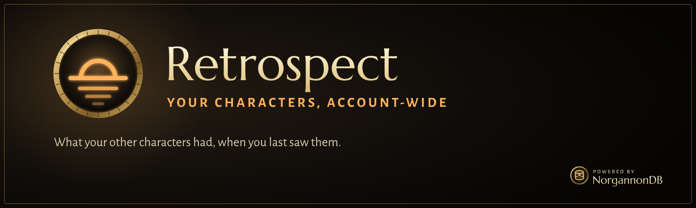

  

  
  
  

> [!WARNING]
> **Very much a work in progress.** This first build has passed its test harness but hasn't been
> played in the game yet, so expect things to need fixing. Bug reports and feedback are welcome in
> [Issues](../../issues). `/retro probe` says what each part can read on your client.

**Retrospect remembers what your other characters had when you last saw them.** Bags, bank, gear,
gold, mail, auctions, recipes, reputations, quests and lockouts, across every character on your
account, in one window.

## What it does

### One rail, one scope
Pick **All characters** or one character on the left. The tabs and the search follow.

### Today
One list with real deadlines instead of a calendar: mail about to expire, auctions sold, money
waiting, profession cooldowns, lockouts ending, bags nearly full, characters fully rested. Facts
only, never "do this next". If something can't wait, one quiet chat line says so at login.

### Honest about what it knows
Every block says when it was last seen. "Never opened" is different from "empty", and the Today page
lists what the totals could be missing.

### Who has it
- **Search every character's** bags, banks, mail, auctions and gear, with place filters and a
  **Can be mailed** filter that hides soulbound items.
- **Mail you send between your characters** counts at once, as "on its way".
- **Tooltips** say who holds an item and where, who can learn a recipe, and which of your characters
  needs an item for a quest. Quest tooltips say who has done it and who is on it.

### Compare
One grid, every character a column: **reputation**, **professions** with recipe counts,
**attunements and keys** built from NorgannonDB rather than a hand-kept list, **lockouts**, and any
**one quest** you type.

### Gold
One value per character per day, kept for a year, on a chart with each character's share.

### One character
Overview, Bags & Bank, Gear, Mail & Auctions, Quests (with "has this character done it?"),
Professions (every recipe, known or not) and Reputation.

## The NorgannonDB suite

|   | Add-on | |
|:-:|---|---|
|  | **[Clairvoyance](https://github.com/zmarotrix/Clairvoyance)** | Quest helper: your objectives on the map, minimap and compass, and a modern tracker |
|  | **[Oracle](https://github.com/zmarotrix/Oracle)** | Dungeon and zone atlas: maps, bosses, loot, zones and professions |
|  | **Retrospect** | Your characters, account-wide: what each one has, knows and has waiting |
|  | **[NorgannonDB](https://github.com/zmarotrix/NorgannonDB)** | The open game database underneath, with **NorgannonDB Core**, the shared runtime |
|  | **[NorgannonDB Collector](https://github.com/zmarotrix/NorgannonDBCollector)** | Help map Azeroth: improves the database while you play |

## Getting started

1. Download **Retrospect**, **[NorgannonDB](https://github.com/zmarotrix/NorgannonDB)** and
   **[NorgannonDB Core](https://github.com/zmarotrix/NorgannonDB_Core)** (on each page: **Code →
   Download ZIP**).
2. Extract them into your WoW Forever `Interface/AddOns` folder, and remove the `-main` that
   GitHub adds to each folder's name, so you end up with `Retrospect`, `NorgannonDB` and
   `NorgannonDB_Core`.
3. Log in on each character once. Open the bank, a mailbox, the auction house and each profession
   once per character, so Retrospect can read them.
4. Type **`/retro`**, or click Retrospect's minimap button.

| Command | What it does |
|---|---|
| `/retro` | open or close Retrospect |
| `/retro arcanite` | who has it: search every character |
| `/retro probe` | what each part can read on this client |
| `/retro settings` | the settings (also under NorgannonDB in the game's Settings) |

Saved data belongs to one WoW account. If you have two accounts on one login, each sees its own
characters; merging them isn't in this version.

---

## Technical details

How it works

- **Private by design.** Nothing is sent anywhere; there are no comms in this version.
- **Saved data** is in `RetrospectDB`, per WoW account. Items are packed into one string per
  container, and id lists into base-36 differences, so a character costs little. The harness budgets
  30 full characters.
- **Nothing replaced.** Events and post-hooks only. Scans are coalesced and wait for combat to end;
  secret values are skipped; a call the client lacks counts as no answer.
- **Built on NorgannonDB Core 1.15**, including its known-recipes scan, shared with the rest of the
  suite. Requires NorgannonDB 1.4.

Retrospect is by Maro. All rights reserved; see [LICENSE](LICENSE).
